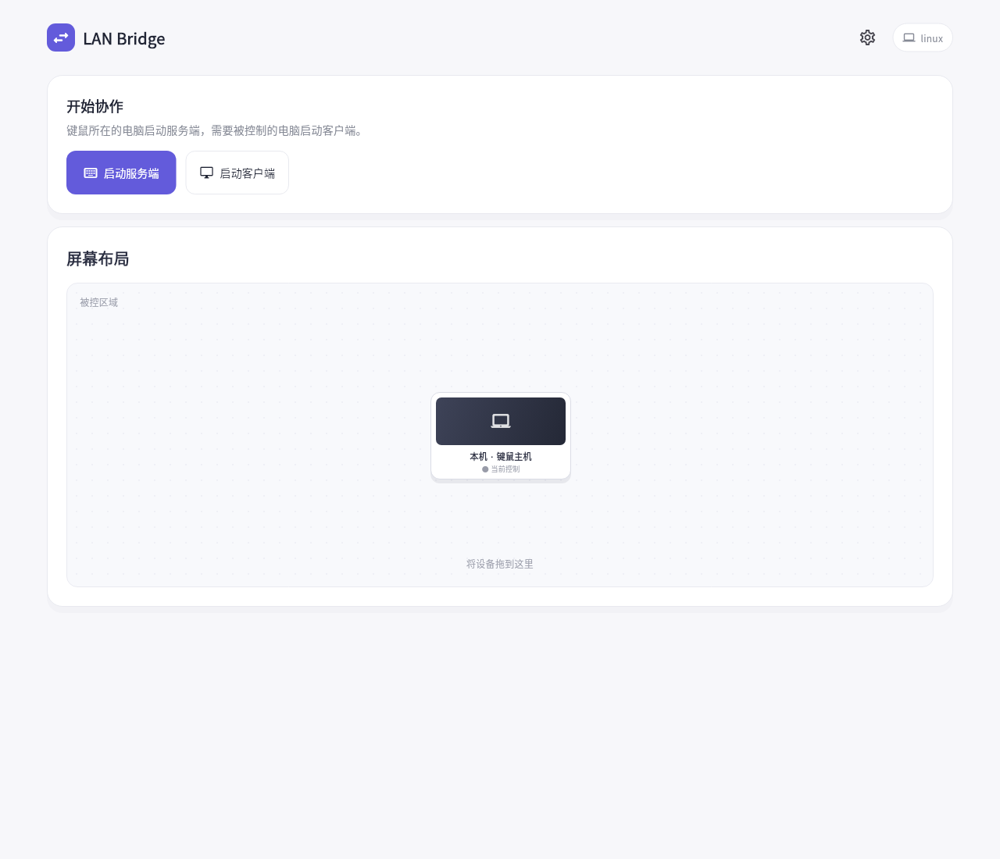
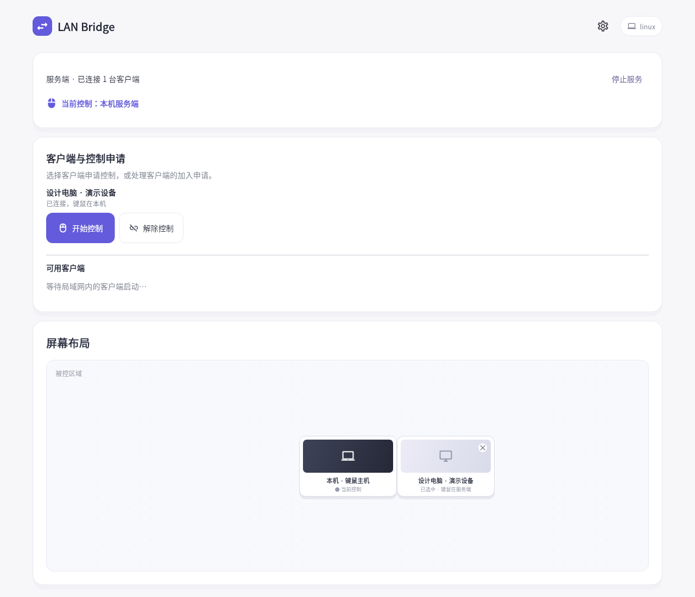

# LAN Bridge

在同一局域网中，用一副键盘和鼠标操作多台 Windows 和 macOS 电脑，并共享剪贴板与文件。

[下载最新发行版](https://github.com/Idealawliet/lan_bridge/releases) · [使用与验收清单](docs/manual-test.md) · [报告问题](https://github.com/Idealawliet/lan_bridge/issues)

> **非商业使用许可**：Copyright © 2026 Idealawliet。未经书面授权，禁止商业使用；完整条款见 [LICENSE](LICENSE)。

## 主要功能

- **连接与安全**：主界面启动服务端或客户端，通过局域网发现或 IP 地址连接；使用 6 位 PIN 双向认证及 AES-256-GCM 加密，两端须使用相同版本。
- **多设备操控**：一台服务端管理最多 16 台客户端；支持四方向屏幕排列、连接时拖动布局，以及不同分辨率的坐标映射。
- **屏幕切换**：可调整边缘触发范围和停留延迟；使用切换快捷键在主机与当前客户端之间切换，可在设置中关闭快捷键。
- **剪贴板与文件**：双向同步文本、图片和原始文件，保留文件名、目录结构与文件内容；可通过文件面板或跨屏拖放发送。
- **状态与诊断**：显示连接时长、延迟、抖动及传输平均速度；传输记录展示文件名、大小、结果和失败原因，记录保留至当前连接断开。
- **更新与桌面体验**：从 GitHub 检查发行版，查看更新说明与下载进度，校验 SHA-256；可选择版本、跳过提醒或稍后安装。支持登录自启和后台托盘。

## 下载与安装

从 [GitHub Releases](https://github.com/Idealawliet/lan_bridge/releases) 下载适用于 Windows 的 EXE 安装器或 macOS 的 DMG，也可选择便携 ZIP。发行包附有 SHA-256 文件，当前为未签名预览版。

macOS 使用前需授予辅助功能、输入监控和本地网络权限。两台电脑需位于可互通的网络；防火墙需允许 TCP 24872 和 UDP 24873。

## 快速开始

1. 在键鼠所在电脑启动**服务端**，在被控电脑启动**客户端**。
2. 在设备列表申请控制或加入，核对客户端显示的 6 位 PIN 并完成配对；也可输入客户端 IP 地址。
3. 在服务端拖动屏幕布局，移动鼠标至相接边缘，或使用切换快捷键进入当前客户端。
4. 从资源管理器或 Finder 拖动文件至屏幕接缝，保持按住鼠标；等待文件就绪后拖至对端目标目录并松开。也可通过文件面板发送或使用剪贴板粘贴。
5. 使用“返回本机”保留连接；使用“解除控制”“离开服务端”或“停止服务”结束相应连接。

| 操作 | Windows | macOS |
| --- | --- | --- |
| 切换主机与当前客户端 | Ctrl + Alt + F12 | Control + Option + F12 |
| 紧急断开并恢复本机 | Ctrl + Alt + Esc | Control + Option + Esc |

切换快捷键在松开组合键后生效；文件传输或拖放过程中请先完成或取消传输。

## 软件截图

以下图片由当前 Flutter 界面渲染；设备、文件和发行版列表使用**演示数据**，并非实机跨设备操作截图。

### 主界面



### 设备与布局



### 文件传输


### 连接与更新设置


## 使用限制

每台电脑当前映射主屏幕；更改缩放、主屏幕或分辨率后请重新连接。文件传输不支持符号链接和特殊文件。跨屏拖放采用复制，原文件不会删除；原拖拽动画取消不代表文件已丢失。Finder / Explorer、系统权限及驱动会影响拖放体验，请在目标设备上按[检查清单](docs/manual-test.md)验证。

## 开发与构建

使用 Flutter 3.47.7：

```bash
flutter pub get --enforce-lockfile
flutter analyze --no-pub
flutter test --no-pub
```

Windows 使用 `scripts/build-windows.ps1`（需要 Visual Studio C++ 和 Inno Setup 6）；macOS 使用 `scripts/build-macos.sh`（需要 Xcode 和 CocoaPods）。核心逻辑位于 `lib/core/`，文件和剪贴板逻辑位于 `lib/sharing/`，原生输入桥位于 `packages/lan_input/`。推送与 `pubspec.yaml` 对应的版本标签会触发 GitHub Actions 验证、打包和发布。

## 商业授权

商业使用请通过[项目 Issues](https://github.com/Idealawliet/lan_bridge/issues)联系版权所有者，说明使用主体、用途、部署范围和分发方式，并在取得书面授权后使用。第三方依赖遵循各自许可证；项目不采用 OSI 开源许可证。
